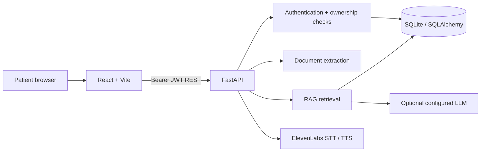

# MediMemory architecture

## Trust boundaries
- Browser stores a short-lived bearer token in localStorage for this hackathon build. A production deployment should prefer secure, HttpOnly, SameSite cookies and CSRF protection.
- Every patient record query scopes by authenticated `user.id`.
- RAG retrieval filters confirmed consultations by the authenticated user.
- Uploaded OCR/PDF text is never auto-confirmed.
- Only selected confirmed excerpts are sent to an optional LLM. ElevenLabs receives audio for transcription and response text for synthesis.
- Demo records are fictional and explicitly marked.

## Main data flows
1. Authentication: password → bcrypt hash → JWT → current user dependency.
2. Consultation: patient input/document extraction → pending review → explicit confirmation.
3. Question answering: patient question → lexical relevance retrieval → confirmed notes → optional constrained LLM or quoted evidence fallback → source references.
4. Voice: browser MediaRecorder → authenticated `/assistant/transcribe` → ElevenLabs Scribe → chat RAG → `/assistant/speak` → ElevenLabs audio.
5. Reminders: confirmed medication → reminder time → in-app due-time check while browser remains open.
